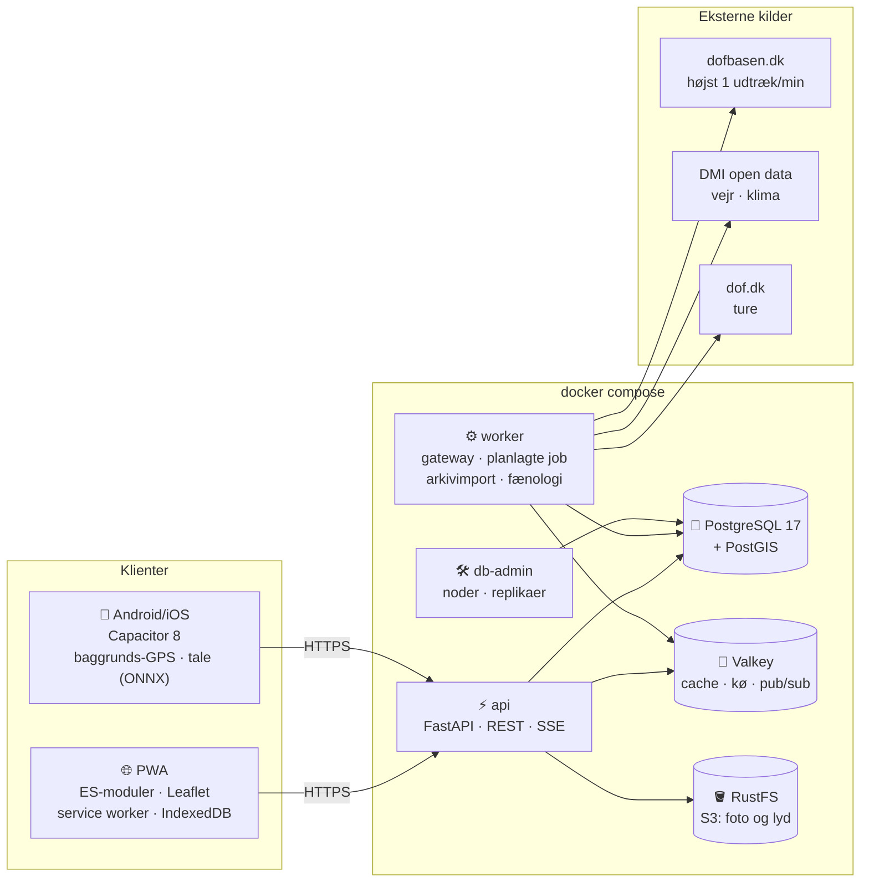

<div align="center">


# DOF.tool

**Feltornitologernes portal – alt fra dagens fund til dine egne ture, samlet i én app.**

Live-feed med tråde og alarmer · indtastning i felten med GPS, tale og offline · lister, scoreboards og fænologi


<!-- Skærmbilleder: læg filerne i docs/screenshots/ med navnene nedenfor (stående telefonformat, fx 1080×2340) -->
<table>
  <tr>
    <td align="center"><br><sub><b>Nu</b> – dagens fund i tråde</sub></td>
    <td align="center"><br><sub><b>Tråd</b> – kort, kommentarer, status</sub></td>
    <td align="center"><br><sub><b>Tur</b> – indtastning i felten</sub></td>
    <td align="center"><br><sub><b>Tale</b> – «2 bomlærker syd»</sub></td>
  </tr>
  <tr>
    <td align="center"><br><sub><b>Lister</b> – år, matrikel, scoreboards</sub></td>
    <td align="center"><br><sub><b>Træk</b> – fænologi og trækvejr</sub></td>
    <td align="center"><br><sub><b>Alarmer</b> – område, art, kategori</sub></td>
    <td align="center"><br><sub><b>Kalender</b> – planlæg trækposten</sub></td>
  </tr>
</table>

</div>

---

## Hvad er DOF.tool?

DOF.tool samler de tidligere apps **DOF.not**, **Boligbirding/Fugleliga** og **Trækfugl** i én PWA med fælles login og
fælles database – og bygger videre med indtastning i felten, alarmer, læring og planlægning. Login sker med
DOFbasen-obserkoden; portalen gemmer aldrig adgangskoder.

| Tidligere app | I DOF.tool |
|---|---|
| **DOF.not** (notifikationer) | *Nu*-feedet med tråde, kort, kommentarer, følg tråd, push og stille timer |
| **Boligbirding / Fugleliga** | *Lister*: årslister, matrikler (`#BB26`), afdelinger, kommuner, egne områder, scoreboards, kapløbsgraf |
| **Trækfugl** | *Træk*: tidligere/senere end normalt, ankomster, trækvejr (DMI), klima |

## Funktioner

### 🔔 Følg med i dag
- **Nu-feed** – dagens observationer samlet i tråde (art + lokalitet + dag), opdateret live. Filtrér på SU, SUB, Bemærk,
  *lokale hits*, fænologi eller *Nær mig*.
- **Tråde** – adfærd, dragt, tider og noter, kort, kommentarer i realtid, tommel op, billeder og lyd fra DOFbasen, og
  status på SU/SUB-fugle (*stadig til stede*, *fløjet*, *ikke genfundet*).
- **Alarmer** – for afdeling, kommune, lokalitet, tegnet polygon, radius eller *din position, der følger dig*. Push til
  browser og app, med stille timer.
- **Kort** – *Live*: kommandokort over Danmark, hvor hver ny ændring popper op på kortet. *Dag*: en valgfri dags SU, SUB,
  Bemærk, lokale hits og fænologi på ét kort (den seneste uge ligger klar).

### 📝 Indtast i felten
- **Ture som i app.dofbasen.dk** – lokalitet (søg eller nærmeste), tider, metode, komplet artsliste, vejr (hentes fra DMI),
  observationer med +1/+10, ynglepar og forstyrrelser.
- **Tale-indtastning** – hold knappen inde og sig «2 bomlærker syd og 5 stære vest». Talen genkendes **på telefonen**
  med en dansk model (CoRal); lyden forlader aldrig enheden.
- **GPS-rute** – optages også med slukket skærm i appen og beskæres automatisk til turens tidsrum.
- **Virker uden net** – arter, adfærd, lokaliteter og de seneste 14 dages ture ligger på enheden. Det, du indtaster,
  sendes automatisk, når der er forbindelse igen.
- **Noget du har glemt?** – når turen afsluttes, foreslås lokalitetens almindeligste arter, som ikke står på turen.

### 📊 Lister og data
- **Lister og scoreboards** – Danmark, matrikel, lokalafdeling, kommune og egne områder; år eller livsliste.
- **Træk og fænologi** – indsatskorrigeret rapporteringsrate, 10/50/90 %-datoer, trends og sammenhæng med temperatur.
- **Lokaliteter og arter** – sider for hver lokalitet og art med år for år, tid på dagen og adfærd.
- **Vejrarkiv** – DMI's 10 km-grid pr. døgn, så hver tråd kan vise *vejret den dag*.

### 🗓️ Planlæg og lær
- **Kalendere for trækposter** – meld dig til, se hvem der kommer, trækvejr og *typisk på denne tid*. ICS-abonnement.
- **DOF-ture** – kommende ture fra dof.dk med filtre, kort og kalenderfil.
- **Læring** – kurser med billede og lyd, gentagelse med Leitner-kasser og quizzer bygget på portalens egne data.
- **Mobgang** – bland optagelser til en flok og træn at høre målarten i mængden.

### 🧩 Showcases
- **DOFbasen** og **Netfugl** genopbygget på portalens backend, med eget admin-panel, roller og REST-API.
  Kan slås til, vises som forhåndsvisning eller slås fra under *Admin → Funktioner*.

Hele beskrivelsen modul for modul står i **[docs/funktioner.md](docs/funktioner.md)**. Hvordan koden er delt i moduler, og
hvor ny kode skal ligge, står i **[docs/arkitektur.md](docs/arkitektur.md)**.

## Tech-stack



| Lag | Teknologi |
|---|---|
| Frontend | Vanilla JavaScript (ES-moduler, intet byggetrin), Leaflet, service worker, IndexedDB |
| App | Capacitor 8 (Android/iOS), native baggrundsposition, ONNX Runtime til tale |
| Backend | Python 3.12, FastAPI, SQLAlchemy (async), server-sent events |
| Data | PostgreSQL 17 + PostGIS (opdeles i bruger- og observationsgruppe med replikaer), Valkey |
| Filer | RustFS (S3-kompatibelt objektlager) |
| Drift | Docker Compose, eget db-admin-panel |

Alt er open source; Google-tjenester er holdt ude, hvor det kan lade sig gøre. Det fulde diagram med alle forbindelser
ligger i [docs/DOF.tool-tech-stack.pdf](docs/DOF.tool-tech-stack.pdf).

## Kom i gang

```bash
cp .env.example .env        # ret adgangskoder, superadmin og stien til arkivet
docker compose up -d --build
```

Åbn `http://localhost:8090`. Første opstart indlæser referencedata, importerer DOFbasen-arkivet (≈ 30 mio. observationer,
ca. en halv time) og starter live-hentningen. Superadmin sættes med `SUPERADMIN_OBSERKODE` og logger ind med sin
DOFbasen-adgangskode.

Opsætning af push, databaser og replikaer, objektlager og gatewayen til dofbasen.dk står i
**[docs/drift.md](docs/drift.md)**. Appen bygges som beskrevet i [app/README.md](app/README.md).

> **Hensyn til dofbasen.dk.** Alt, der hentes fra dofbasen.dk, går gennem én gateway med højst ét udtræk i minuttet.
> Én dagsliste dækker alle moduler, og historik kommer fra det lokale arkiv.

## Udvikling

```bash
docker compose run --rm --no-deps -v ./server:/app/server -w /app/server api \
  sh -c "pip install -q pytest pytest-asyncio && python -m pytest -q"
```

`web/` er mountet ind i api-containeren, så frontend-ændringer kræver ikke rebuild.
Backend-ændringer: `docker compose up -d --build api worker`.

```
server/portal/
  dof/        gateway (rate limit), jobs (ét kald hver), parse, classify, ingest (COPY), archive, reference
  services/   feed, alerts, push, lists, areas (PostGIS), phenology, dmi, learning, auth
  api/        FastAPI-routere
  seed/       referencedata, kommunepolygoner, kursusindhold
web/          PWA uden build-trin (ES-moduler), Leaflet vendoreret
app/          Capacitor-app (Android/iOS)
dbadmin/      superadmin-panel til databaserne
docs/         drift, funktioner, showcases og tech-stack
```

De gamle apps ligger i `Old Apps/` (inkl. `DOF.tool-v0.1`) til reference.
